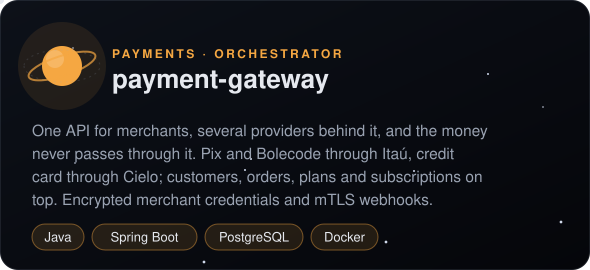
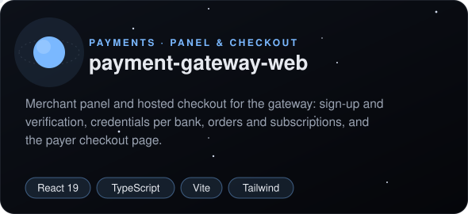
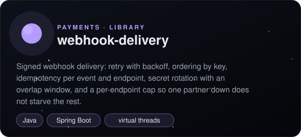
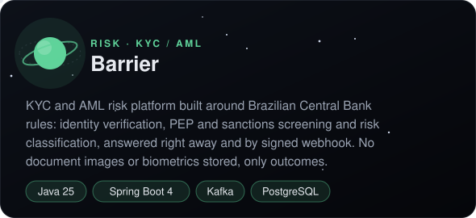
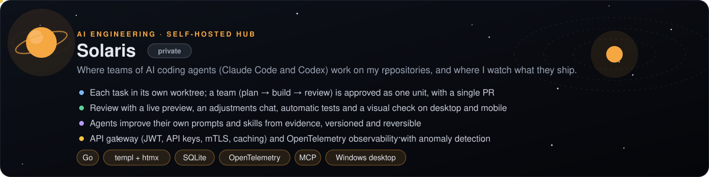
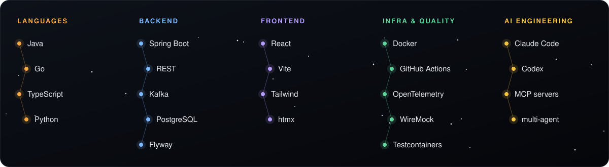

**Backend engineer from Brazil** · Java & Spring · payments, risk and distributed systems · building tools that let AI agents ship code safely.

I like backend work where being *almost* right is not an option: money that has to reconcile, webhooks that must arrive once per event, risk decisions that a regulator can audit. I write the decisions down (ADRs, specs) and keep the reasoning next to the code.

  
  

  
  

  

